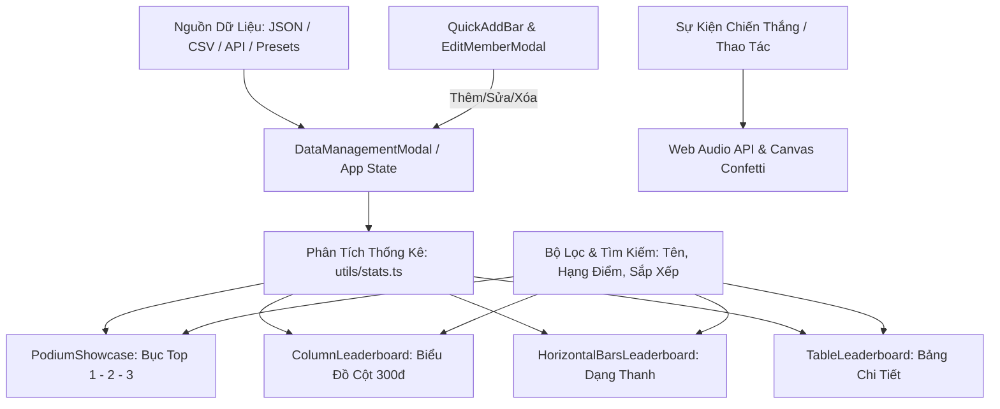

# TÀI LIỆU CẤU TRÚC CHỨC NĂNG VÀ CẤU HÌNH TRUYỀN NHẬN DỮ LIỆU
## Ứng Dụng: ScoreChart Pro - Bảng Xếp Hạng Điểm Thi Đấu Trực Quan

---

## MỤC LỤC
1. [Tổng Quan Ứng Dụng & Công Nghệ](#1-tổng-quan-ứng-dụng--công-nghệ)
2. [Cấu Trúc Thư Mục Dự Án](#2-cấu-trúc-thư-mục-dự-án)
3. [Cấu Trúc Các Phân Hệ Chức Năng](#3-cấu-trúc-các-phân-hệ-chức-năng)
4. [Mô Hình Dữ Liệu (Data Models & TypeScript Schema)](#4-mô-hình-dữ-liệu-data-models--typescript-schema)
5. [Chuẩn Dữ Liệu Truyền & Nhận (Import / Export Format)](#5-chuẩn-dữ-liệu-truyền--nhận-import--export-format)
6. [Cấu Hình Môi Trường & Kết Nối Backend / API](#6-cấu-hình-môi-trường--kết-nối-backend--api)
7. [Hướng Dẫn Mở Rộng Đồng Bộ Dữ Liệu Thời Gian Thực (Real-time)](#7-hướng-dẫn-mở-rộng-đồng-bộ-dữ-liệu-thời-gian-thực-real-time)

---

## 1. TỔNG QUAN ỨNG DỤNG & CÔNG NGHỆ

**ScoreChart Pro** là hệ thống bảng xếp hạng và biểu đồ trực quan hóa điểm thi đua/cuộc thi theo thời gian thực. Ứng dụng hỗ trợ thang điểm chuẩn linh hoạt (mặc định 300 điểm), tự động tính toán bục vinh quang (Top 1 Quán Quân, Top 2 Á Quân, Top 3), vẽ biểu đồ cột tương tác, hỗ trợ âm thanh Web Audio và pháo hoa ăn mừng.

### Công nghệ cốt lõi:
- **Framework UI**: React 19 (TypeScript)
- **Công cụ đóng gói & Dev Server**: Vite 8
- **Styling**: Tailwind CSS v4
- **Thư viện Animation & Icon**: Lucide React, Motion
- **Âm thanh & Hiệu ứng tương tác**: Web Audio API (tổng hợp sóng âm Synth không phụ thuộc file mp3 ngoài), Canvas-Confetti

---

## 2. CẤU TRÚC THƯ MỤC DỰ ÁN

```text
Bangxephang/
├── .env                              # Biến môi trường hệ thống
├── .env.local                        # Cấu hình biến môi trường cục bộ
├── index.html                        # Entrypoint HTML
├── package.json                      # Quản lý phụ thuộc và lệnh chạy
├── tsconfig.json                     # Cấu hình TypeScript
├── vite.config.ts                    # Cấu hình Vite & plugin React / Tailwind
│
└── src/
    ├── main.tsx                      # Khởi tạo React DOM root
    ├── App.tsx                       # Component chính điều phối state toàn cục
    ├── index.css                     # Tailwind CSS v4 & custom styles
    │
    ├── types/                        # Khai báo kiểu dữ liệu (Data Schemas)
    │   └── leaderboard.ts            # Interfaces cho Member, Dataset, Stats, Payload
    │
    ├── components/                   # Các khối giao diện chức năng
    │   ├── Header.tsx                # Thanh điều hướng, nút âm thanh, pháo hoa & nạp dữ liệu
    │   ├── PodiumShowcase.tsx        # Bục vinh quang Top 1, Top 2, Top 3
    │   ├── ColumnLeaderboard.tsx     # Biểu đồ cột trực quan thang điểm 300
    │   ├── HorizontalBarsLeaderboard.tsx # Biểu đồ dạng thanh ngang
    │   ├── TableLeaderboard.tsx      # Bảng danh sách chi tiết và thao tác thành viên
    │   ├── QuickAddBar.tsx           # Thanh thêm nhanh thành viên tức thì
    │   ├── EditMemberModal.tsx       # Hộp thoại chỉnh sửa thông tin thành viên
    │   └── DataManagementModal.tsx   # Quản lý, xuất/nhập JSON, CSV và bộ mẫu
    │
    ├── data/
    │   └── presets.ts                # Bộ dữ liệu mẫu khởi đầu và các kịch bản thi đấu
    │
    └── utils/
        ├── audio.ts                  # Bộ âm thanh Web Audio API (Triumph, Click, Pop)
        ├── colors.ts                 # Bảng màu phân hạng, gradient bục và avatar
        ├── confetti.ts               # Hiệu ứng bắn pháo hoa mừng chiến thắng
        └── stats.ts                  # Hàm tính toán phân tích chỉ số thống kê
```

---

## 3. CẤU TRÚC CÁC PHÂN HỆ CHỨC NĂNG

### Sơ Đồ Kiến Trúc Luồng Hoạt Động (Flowchart):



### Chi tiết các phân hệ:

1. **Phân hệ Hiển thị Trực quan (Display Views)**:
   - **Podium + Columns (`podium-columns`)**: Kết hợp bục vinh quang Top 3 ở trên và biểu đồ cột các thí sinh ở dưới.
   - **Biểu đồ Cột (`columns`)**: Tập trung trực quan hoá chiều cao cột điểm theo thang điểm 300, có chỉ số % hoàn thành và phân màu bậc điểm.
   - **Thanh Ngang (`horizontal-bars`)**: Dễ theo dõi danh sách dài với thanh tiến độ ngang.
   - **Bảng Chi Tiết (`table`)**: Chế độ bảng truyền thống xem đầy đủ tên, điểm, phòng ban, ghi chú và các nút thao tác sửa/xóa.

2. **Phân hệ Thống kê Tự động (`stats.ts`)**:
   - `totalMembers`: Tổng số người tham gia dự kiến (`totalParticipants`).
   - `submittedCount`: Số người đã có bài thi / có điểm thực tế.
   - `completionRate`: Tỷ lệ % người tham gia đã nộp bài (`submitted / total`).
   - `highestScore` & `highestScorerName`: Điểm cao nhất và tên Quán quân.
   - `averageScore`: Điểm trung bình của những người đã nộp.
   - `medianScore`: Điểm trung vị.
   - `lowestScore`: Điểm thấp nhất.

3. **Phân hệ Bộ Lọc & Tìm Kiếm (Filtering & Sorting)**:
   - Tìm kiếm realtime theo tên thí sinh hoặc tên phòng ban/đơn vị.
   - Lọc theo phân tầng năng lực (Tier Filter):
     - Xuất sắc (>= 90% điểm cao nhất)
     - Giỏi (75% - 90%)
     - Trung bình (50% - 75%)
     - Cần nỗ lực (< 50%)
   - Sắp xếp: Điểm cao xuống thấp, Điểm thấp lên cao, Tên A-Z, Tên Z-A (chuẩn tiếng Việt).

4. **Phân hệ Tương tác & Âm thanh**:
   - Hiệu ứng âm thanh điện tử tổng hợp khi thêm thí sinh mới, chỉnh sửa, click, hoặc chúc mừng Quán quân.
   - Pháo hoa chúc mừng vinh danh tự động hoặc kích hoạt qua nút *"Tôn Vinh Top 1"*.

---

## 4. MÔ HÌNH DỮ LIỆU (DATA MODELS & TYPESCRIPT SCHEMA)

Các định nghĩa kiểu dữ liệu trong file `src/types/leaderboard.ts`:

### 4.1. Thông tin từng thành viên (`LeaderboardMember`)
```typescript
export interface LeaderboardMember {
  id: string;             // ID định danh duy nhất (UUID hoặc chuỗi ngẫu nhiên)
  name: string;           // Tên thí sinh / thành viên (bắt buộc)
  score: number;          // Điểm số đạt được (số thực hoặc nguyên)
  avatarColor?: string;   // Màu avatar đại diện (tùy chọn)
  department?: string;    // Phòng ban / Đơn vị / Lớp (tùy chọn)
  notes?: string;         // Ghi chú thêm (tùy chọn)
}
```

### 4.2. Bộ dữ liệu bảng xếp hạng (`LeaderboardDataset`)
```typescript
export interface LeaderboardDataset {
  id: string;             // Mã định danh của bộ dữ liệu
  title: string;          // Tiêu đề cuộc thi / bảng điểm
  subtitle: string;       // Mô tả phụ (thang điểm chuẩn, ngày thi đấu...)
  category: string;       // Danh mục / Thể loại
  totalMembers: number;   // Tổng số người tham gia (totalParticipants)
  maxPossibleScore: number; // Điểm tối đa của thang điểm (mặc định: 300)
  items: LeaderboardMember[]; // Danh sách các thành viên và điểm số
}
```

### 4.3. Chỉ số thống kê tổng hợp (`LeaderboardStats`)
```typescript
export interface LeaderboardStats {
  totalMembers: number;       // Tổng thí sinh
  submittedCount: number;     // Số thí sinh đã có điểm
  completionRate: number;     // Tỷ lệ hoàn thành (%)
  highestScore: number;       // Điểm cao nhất
  highestScorerName: string;  // Tên người đứng đầu
  averageScore: number;       // Điểm trung bình
  medianScore: number;        // Điểm trung vị
  lowestScore: number;        // Điểm thấp nhất
}
```

---

## 5. CHUẨN DỮ LIỆU TRUYỀN & NHẬN (IMPORT / EXPORT FORMAT)

Ứng dụng hỗ trợ chuẩn giao tiếp dữ liệu chuẩn quốc tế và khả năng thích ứng linh hoạt:

### 5.1. Chuẩn JSON Khuyến Nghị (Standard Payload Schema)
Đây là cấu trúc chuẩn định dạng mảng 1 phần tử hoặc đối tượng đơn mà Modal Nhập/Xuất của ứng dụng tự động tạo ra và đọc vào:

```json
[
  {
    "totalParticipants": 8,
    "topLeader": {
      "name": "Viễn",
      "score": 8
    },
    "runnerUp": {
      "name": "Đăng",
      "score": 3
    },
    "leaderboard": [
      { "name": "Viễn", "score": 8, "department": "Kỹ Thuật" },
      { "name": "Đăng", "score": 3, "department": "Thiết Kế" },
      { "name": "Hiền", "score": 1, "department": "Sản Phẩm" },
      { "name": "Đức Anh", "score": 0, "department": "Kinh Doanh" },
      { "name": "Nguyên", "score": 0 },
      { "name": "Huyền", "score": 0 },
      { "name": "Khang", "score": 0 },
      { "name": "Hương", "score": 0 }
    ]
  }
]
```

### 5.2. Các định dạng JSON tương thích khác (Auto-Detect)
Trình phân giải JSON trong `DataManagementModal.tsx` tự động nhận diện thông minh các biến thể sau:
1. **Dạng mảng thuần đối tượng**:
   ```json
   [
     { "name": "Nguyễn Hoàng Nam", "score": 285 },
     { "name": "Trần Thị Mai Linh", "score": 260 }
   ]
   ```
2. **Dạng Object đơn bọc trường `items` hoặc `data`**:
   ```json
   {
     "title": "Bảng Điểm Kiểm Tra",
     "totalMembers": 20,
     "items": [
       { "name": "Lê Bảo", "score": 240 }
     ]
   }
   ```

### 5.3. Chuẩn Dữ Liệu CSV
Khi người dùng nhập hoặc xuất dữ liệu qua tab CSV:
```csv
name,score,department
"Nguyễn Hoàng Nam",285,"Công nghệ thông tin"
"Trần Thị Mai Linh",260,"Thiết kế đồ họa"
"Lê Quốc Bảo",240,"Phân tích dữ liệu"
```

---

## 6. CẤU HÌNH MÔI TRƯỜNG & KẾT NỐI BACKEND / API

### 6.1. File cấu hình `.env` & `.env.local`
Trong thư mục gốc dự án đã thiết lập các biến:

```env
# URL của dịch vụ hoặc frontend cục bộ
APP_URL="http://localhost:3000"

# (Tùy chọn) API Key nếu tích hợp dịch vụ AI Studio / Gemini
GEMINI_API_KEY=""

# (Khuyến nghị thêm) Địa chỉ máy chủ Backend nếu có
VITE_API_BASE_URL="http://localhost:5000/api"
```

> **Lưu ý Vite**: Tất cả các biến môi trường muốn sử dụng ở phía Client (React) cần có tiền tố `VITE_` (ví dụ: `import.meta.env.VITE_API_BASE_URL`).

---

## 7. HƯỚNG DẪN MỞ RỘNG ĐỒNG BỘ DỮ LIỆU THỜI GIAN THỰC (REAL-TIME)

Hệ thống đã tích hợp sẵn lệnh `fetch()` trực tiếp tới Webhook máy chủ:
👉 **`http://localhost:1234/webhook/leaderboard`**

### 7.1. Cấu hình & Lệnh fetch() trong mã nguồn:

Trong file `src/utils/api.ts`:
```typescript
import { LeaderboardDataset } from '../types/leaderboard';

export const LEADERBOARD_WEBHOOK_URL =
  import.meta.env.VITE_LEADERBOARD_API_URL || 'http://localhost:1234/webhook/leaderboard';

/**
 * Lệnh fetch() dữ liệu bảng xếp hạng từ link webhook: http://localhost:1234/webhook/leaderboard
 */
export async function fetchLeaderboardFromWebhook(
  url: string = LEADERBOARD_WEBHOOK_URL
): Promise<LeaderboardDataset> {
  const response = await fetch(url, {
    method: 'GET',
    headers: { 'Accept': 'application/json' },
  });

  if (!response.ok) {
    throw new Error(`Lỗi máy chủ HTTP ${response.status}: ${response.statusText}`);
  }

  const json = await response.json();
  return parseWebhookPayload(json);
}
```

Và sử dụng tự động trong `src/App.tsx`:
```typescript
// 1. Tự động fetch khi trang vừa tải
useEffect(() => {
  handleSyncWebhook();
}, [handleSyncWebhook]);

// 2. Tự động đồng bộ (Polling) mỗi 10 giây nếu bật Auto Sync
useEffect(() => {
  if (!autoSync) return;
  const interval = setInterval(() => {
    handleSyncWebhook();
  }, 10000);
  return () => clearInterval(interval);
}, [autoSync, handleSyncWebhook]);
```

### 7.2. Cách 2: Kết Nối Bằng WebSocket Hoặc SSE (Server-Sent Events)
Để cập nhật theo thời gian thực (ví dụ trong cuộc thi đang diễn ra):

```typescript
useEffect(() => {
  const socket = new WebSocket('ws://localhost:5000/ws/leaderboard');

  socket.onmessage = (event) => {
    const updatedPayload = JSON.parse(event.data);
    // Cập nhật dataset dựa trên payload nhận được
    if (updatedPayload.leaderboard) {
      setDataset(prev => ({
        ...prev,
        totalMembers: updatedPayload.totalParticipants || prev.totalMembers,
        items: updatedPayload.leaderboard.map((item: any, idx: number) => ({
          id: `member-${idx}`,
          name: item.name,
          score: item.score,
          department: item.department,
        }))
      }));
    }
  };

  return () => socket.close();
}, []);
```

---

## TỔNG KẾT
| Chức Năng | Vị Trí Code Chính | Định Dạng Dữ Liệu |
| :--- | :--- | :--- |
| **Quản lý dữ liệu** | `src/components/DataManagementModal.tsx` | JSON Standard Payload, CSV |
| **Khai báo kiểu** | `src/types/leaderboard.ts` | TypeScript Interfaces |
| **Bục vinh quang** | `src/components/PodiumShowcase.tsx` | Top 1, Top 2, Top 3 |
| **Biểu đồ cột** | `src/components/ColumnLeaderboard.tsx` | Max 300 điểm, CSS Bar Animation |
| **Bảng danh sách** | `src/components/TableLeaderboard.tsx` | Bảng tương tác, CRUD thành viên |
| **Âm thanh & Pháo hoa** | `src/utils/audio.ts`, `src/utils/confetti.ts` | Web Audio API Synth, Confetti |
