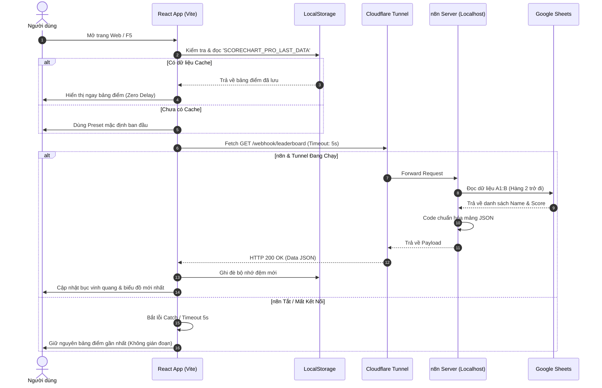

# HƯỚNG DẪN NÂNG CẤP BỘ NHỚ ĐỆM & CẤU HÌNH KẾT NỐI n8n CHO SCORECHART PRO

---

## 1. MỤC TIÊU NÂNG CẤP
- **Đồng bộ thời gian thực**: Web tự động gọi n8n Webhook để nạp điểm mới nhất từ Google Sheets.
- **Cơ chế Dual-Layer Cache (Bộ nhớ đệm kép)**:
  - Khi người dùng mở web, dữ liệu lần cập nhật gần nhất được load tức thì từ `localStorage`.
  - Nếu n8n và Cloudflare Tunnel đang hoạt động: Dữ liệu mới nhất được nạp và tự động ghi đè bộ nhớ đệm.
  - Nếu n8n tắt (máy tắt, mất mạng, đóng tunnel): Web **không bị trắng trang**, giữ nguyên 100% dữ liệu của lần tải thành công gần nhất.
  - Thiết lập cơ chế **Request Timeout (5 giây)** để tránh tình trạng web bị treo hoặc xoay chờ quá lâu khi API n8n không phản hồi.

---

## 2. KIẾN TRÚC DỮ LIỆU & LUỒNG ĐỒNG BỘ



---

## 3. CẤU HÌNH BIẾN MÔI TRƯỜNG (.env)

Tạo hoặc cập nhật các file biến môi trường ở thư mục gốc của dự án React.

### File: `.env` (hoặc `.env.local`)
```env
# Địa chỉ công khai n8n qua Cloudflare Tunnel
VITE_N8N_API_URL="https://presidential-tabs-excluding-toolbox.trycloudflare.com/webhook/leaderboard"

# Thời gian tự động quét lại dữ liệu (tính bằng mili-giây, ví dụ: 30000 = 30s)
VITE_SYNC_INTERVAL=30000
```

> **Lưu ý**: Khi deploy lên **Render**, bạn vào mục **Environment** trong dashboard của Render và thêm biến `VITE_N8N_API_URL` với giá trị tương ứng.

---

## 4. CHI TIẾT MÃ NGUỒN CẦN TRIỂN KHAI

### 4.1. Tạo Module Quản Lý API (`src/utils/api.ts`)
Module này chịu trách nhiệm:
1. Gọi đến endpoint n8n Webhook.
2. Quản lý cơ chế AbortController (Timeout 5s).
3. Chuẩn hóa dữ liệu trả về trước khi đưa vào React State.

```typescript
// src/utils/api.ts
export interface LeaderboardApiResponse {
  totalParticipants: number;
  topLeader: {
    name: string;
    score: number;
  };
  runnerUp: {
    name: string;
    score: number;
  };
  leaderboard: Array<{
    name: string;
    score: number;
    department?: string;
  }>;
}

const API_URL =
  import.meta.env.VITE_N8N_API_URL ||
  'https://presidential-tabs-excluding-toolbox.trycloudflare.com/webhook/leaderboard';

/**
 * Gọi API n8n lấy bảng xếp hạng mới nhất kèm cơ chế timeout
 */
export async function fetchLeaderboardFromN8N(
  timeoutMs: number = 5000
): Promise<LeaderboardApiResponse | null> {
  const controller = new AbortController();
  const timer = setTimeout(() => controller.abort(), timeoutMs);

  try {
    const response = await fetch(API_URL, {
      method: 'GET',
      headers: {
        'Accept': 'application/json',
      },
      signal: controller.signal,
    });

    clearTimeout(timer);

    if (!response.ok) {
      throw new Error(`HTTP Error: ${response.status} - ${response.statusText}`);
    }

    const rawData = await response.json();

    // Chuẩn hóa nếu backend trả về mảng bọc ngoài [{ ... }]
    const data: LeaderboardApiResponse = Array.isArray(rawData) ? rawData[0] : rawData;

    if (!data || !Array.isArray(data.leaderboard)) {
      throw new Error('Dữ liệu API trả về không đúng định dạng schema');
    }

    return data;
  } catch (error: any) {
    if (error.name === 'AbortError') {
      console.warn(`[n8n API] Hết thời gian chờ (${timeoutMs}ms). Máy chủ n8n có thể đang tắt.`);
    } else {
      console.warn('[n8n API] Không thể nạp bảng điểm:', error.message);
    }
    return null;
  }
}
```

---

### 4.2. Cập Nhật State & Tích Hợp Cache Tại `src/App.tsx`

Cập nhật `App.tsx` để tích hợp:
1. **Hydration ban đầu**: Đọc từ cache ngay lúc render đầu tiên.
2. **Sync dữ liệu**: Cập nhật từ n8n và tự ghi đè vào cache.
3. **Polling định kỳ**: Tự động lấy điểm mới sau mỗi 30 giây nếu trang đang mở.

```tsx
// src/App.tsx
import React, { useState, useEffect, useCallback } from 'react';
import { fetchLeaderboardFromN8N } from './utils/api';
import { LeaderboardDataset } from './types/leaderboard';
import { defaultLeaderboardDataset } from './data/presets'; // Dataset khởi tạo mặc định

const CACHE_KEY = 'SCORECHART_PRO_LAST_DATA';
const SYNC_INTERVAL = Number(import.meta.env.VITE_SYNC_INTERVAL) || 30000;

export const App: React.FC = () => {
  // 1. Khởi tạo State: Ưu tiên đọc từ LocalStorage ngay lúc render đầu tiên
  const [dataset, setDataset] = useState<LeaderboardDataset>(() => {
    try {
      const cached = localStorage.getItem(CACHE_KEY);
      if (cached) {
        return JSON.parse(cached);
      }
    } catch (err) {
      console.error('Lỗi khi đọc cache ban đầu:', err);
    }
    return defaultLeaderboardDataset;
  });

  const [isSyncing, setIsSyncing] = useState<boolean>(false);
  const [lastSyncTime, setLastSyncTime] = useState<Date | null>(null);

  // 2. Hàm đồng bộ dữ liệu từ n8n
  const syncLeaderboard = useCallback(async () => {
    setIsSyncing(true);
    const remoteData = await fetchLeaderboardFromN8N();

    if (remoteData && remoteData.leaderboard) {
      setDataset((prev) => {
        const updated: LeaderboardDataset = {
          ...prev,
          totalMembers: remoteData.totalParticipants || remoteData.leaderboard.length,
          items: remoteData.leaderboard.map((item, index) => ({
            id: `member-${index}-${item.name.replace(/\s+/g, '-').toLowerCase()}`,
            name: item.name,
            score: Number(item.score) || 0,
            department: item.department || 'Thành viên',
          })),
        };

        // Lưu bản ghi thành công vào LocalStorage
        try {
          localStorage.setItem(CACHE_KEY, JSON.stringify(updated));
          setLastSyncTime(new Date());
        } catch (e) {
          console.error('Không thể lưu vào LocalStorage:', e);
        }

        return updated;
      });
    }

    setIsSyncing(false);
  }, []);

  // 3. Effect chạy khi nạp trang và thiết lập chu kỳ quét lại (Polling)
  useEffect(() => {
    // Gọi ngay khi mở trang
    syncLeaderboard();

    // Thiết lập quét định kỳ
    const intervalId = setInterval(syncLeaderboard, SYNC_INTERVAL);
    return () => clearInterval(intervalId);
  }, [syncLeaderboard]);

  return (
    <div className="min-h-screen bg-slate-950 text-white">
      {/* (Tùy chọn) Thanh trạng thái hiển thị tình trạng đồng bộ */}
      <div className="flex justify-end p-2 text-xs text-slate-400 gap-4">
        <span>
          {isSyncing ? 'Đang kiểm tra điểm mới...' : 'Dữ liệu: Đã lưu gần nhất'}
        </span>
        {lastSyncTime && (
          <span>Cập nhật lúc: {lastSyncTime.toLocaleTimeString()}</span>
        )}
      </div>

      {/* Render các components giao diện chính: Podium, Column, Table... */}
      {/* <PodiumShowcase items={dataset.items} /> */}
      {/* <ColumnLeaderboard items={dataset.items} maxScore={dataset.maxPossibleScore} /> */}
    </div>
  );
};

export default App;
```

---

## 5. KIỂM THỬ KỊCH BẢN THỰC TẾ

| Tình huống kiểm thử | Hành vi hệ thống | Kết quả đạt yêu cầu |
| :--- | :--- | :--- |
| **1. n8n đang mở + Tunnel đang chạy** | Web gọi `fetch()`, n8n lấy điểm Sheets mới nhất. | Bảng điểm cập nhật số mới, cache `localStorage` được làm mới. |
| **2. Tắt cmd Cloudflare hoặc tắt n8n** | Web gọi `fetch()`, quá 5s kích hoạt `controller.abort()`. | Bắt lỗi trong `catch`, giao diện **vẫn giữ nguyên** bảng điểm trước đó, không bị lỗi màn hình. |
| **3. Tải lại trang (F5) khi n8n đang tắt** | Khởi tạo state đọc ngay `localStorage`. | Màn hình hiển thị ngay bảng điểm gần nhất (không cần chờ n8n phản hồi). |
| **4. n8n được bật lại** | Sau chu kỳ `SYNC_INTERVAL` (30 giây) hoặc sau khi F5. | Web tự kết nối lại và nạp các thay đổi mới trên Google Sheets. |

---

## 6. HƯỚNG DẪN KHI TRIỂN KHAI LÊN RENDER

1. **Đẩy mã nguồn lên GitHub**:
   ```bash
   git add .
   git commit -m "feat: Nang cap bo nho dem cache va module API n8n"
   git push origin main
   ```
2. **Cấu hình trên Dashboard Render**:
   - Truy cập trang quản trị Service của bạn trên Render.
   - Chọn tab **Environment**.
   - Thêm Environment Variable:
     - **Key**: `VITE_N8N_API_URL`
     - **Value**: `https://presidential-tabs-excluding-toolbox.trycloudflare.com/webhook/leaderboard`
   - Bấm **Save Changes** để Render tự động build lại.